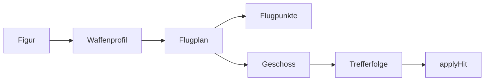

# ⚔️ Waffen, Flugbahnen und Treffer

Jede Figur beginnt mit ihrer eigenen Waffe. Die Fledermaus wechselt weiter zwischen
Speer und Morgenstern. Die Vorschau schaut nur nach und verbraucht keinen Schuss.

**Zielbindung** wirft zum gewählten Gegner. 🎯 oder Tab wechselt das Ziel.
**Frei zielen** benutzt den gewählten Landungsort. Die Schwerkraft wird beim Abwurf
ausgeglichen. Maus oder Finger wählen den Punkt; Aufladen verschiebt ihn nicht.
Du kannst auch am Schießknopf ziehen, um den Punkt vorsichtig zu verschieben.
Q oder der Zielmodus-Knopf wechselt zwischen beiden Arten.
Gedrückt halten lädt auf, Loslassen wirft. Die Ladung erhöht das Tempo; bei
Zielbindung hilft auch bei kurzen Würfen beim Vorhalten auf bewegte Gegner.
Die [Spielanleitung](spielanleitung.html#zielen) erklärt Techniken und Tipps.

## Was gehört wohin?

| Datei | Aufgabe |
|---|---|
| `js/config.js` → `CHAR_STATS` | Normalen Trefferschaden, Wurfpause und Lauftempo pro Figur ändern |
| `js/config.js` → `waffenProfile` | Flugtempo, Schwerkraft und Trefferfolgen ändern |
| `js/geschosse.js` | Nächste Waffe, Flugplan und Flugarten |
| `js/zielhilfe.js` | Freies Zielen, Flugpunkte und Explosionskreis |
| `js/zielen.js` | Gegner auswählen und Schuss aufladen |
| `js/bombs.js` | Geschoss erzeugen, zeichnen und entfernen |
| `js/trefferfolgen.js` | Explosionen, Feuer und Gift |
| `js/physics.js` → `applyHit` | Leben, Punkte und K.o. |

Waffen sind einfache Datenobjekte. Kleine Funktionen kümmern sich jeweils um eine
Aufgabe. Flugarten und Trefferfolgen haben eigene Funktionslisten zum Erweitern.
Die Dateien nutzen normale Script-Tags; `game.js` startet zuletzt.

## Die ersten Waffenwerte

Tempo beschreibt den Weg zum Ziel pro 60-Hz-Bild, vor dem Karten-Maßstab.
Bei Bogenwürfen kommt die Bewegung nach oben und unten dazu.
Schnellere Geschosse machen meistens weniger Schaden. Wurfpausen und Spezialkräfte
bleiben Eigenschaften der Figur und zählen bei der Balance ebenfalls.

| Figur / Waffe | Tempo | Sofort-Schaden | Besonderheit |
|---|---:|---:|---|
| Kobold / Klinge | 12 | 3,4 | Normaler Klingenwurf |
| Mais / Lanze | 15 | 2,7 | Flacher Bogen; Popcorn bleibt Spezialkraft |
| Katze / Stachelkeule | 8 | 3 | Schwerer Bogen, dreht sich |
| Maus / Lanze | 14 | 2,9 | Flacher Bogen |
| Goblin / Dreizack | 11 | 4,1 | Mittlerer Bogen |
| Drache / Feuerball | 10 | 5,1 | Leichte Welle; danach 4 × 0,5 Feuerschaden |
| Zeus / Blitz | 20 | 6,4 | Ohne Schwerkraft |
| Musialla / Ball | 12 | 3,4 | Bogen und Drehung |
| Yamal / Ball | 12 | 4,2 | Bogen und Drehung |
| Fledermaus / Speer | 16 | 3,5 | Schnell und flach |
| Fledermaus / Morgenstern | 8,5 | 3,5 | Langsam und schwer |

Das sind Startwerte für Spieltests. Explosionen können mehrere Gegner treffen;
darum zählt neben dem Schaden pro Treffer auch die Größe des Bereichs.

## Eine Waffe ändern oder ergänzen

1. Ein Profil unter `GAME_CONFIG.waffenProfile` anlegen oder ändern.
2. Die Kennung bei der Figur unter `<figur>Weapons` eintragen. Mehrere Kennungen
   werden der Reihe nach geworfen. Eine neue Runde beginnt bei der ersten Waffe.
3. Bei einem neuen Aussehen `drawWeapon` in `js/waffen.js` ergänzen.

| Wert | Bedeutung |
|---|---|
| `tempo` | Flugtempo; wird durch Aufladen erhöht |
| `schaden` | Reservewert; normale Treffer nutzen zuerst `CHAR_STATS.<figur>.attackDamage` |
| `schwerkraft` | Anteil der Welt-Schwerkraft: 0 = kein Fall, 1 = normal |
| `bewegung` | `bogen` oder `welle`; neue Funktion in `FLUGARTEN` ergänzen |
| `drehung` | Radiant pro Bild; 0 = Spitze folgt der Flugrichtung |
| `explosionsRadius` | 0 = direkt; größer als 0 = Bereichsschaden |
| `lebensdauerMs` | Spätestens dann wird ein verlorenes Geschoss entfernt |
| `trefferfolgen` | Zusätzliche Folgen, z. B. Feuer oder Gift |

Gemeinsame Vorgaben stehen im Profil `default`. Einzelne Waffen überschreiben nur
abweichende Werte. Bestehende Kennungen wie `bomb` oder `spear` passen zur Zeichnung.
Die neu eingeführten Werte und Funktionen heißen deutsch.

Das Profil `venom` ist vorbereitet, aber noch keiner Figur zugeteilt.
Zum lokalen Ausprobieren z. B. `mausWeapons: ['venom']` und `mausBomb: '🧪'` setzen.

## Explosionen und Zeit-Schaden

Explosionen treffen alle Gegner, deren Körper den Kreis berührt. Werfer, Freunde
und versteckte Mäuse bleiben geschützt. Jede Figur bekommt pro Explosion einmal
Schaden. Explosivwaffen zünden auch ohne direkten Treffer am Ende des geplanten
Wurfs, spätestens an ihrer Reichweitengrenze und bei Wandkontakt sofort.
Mais' Spezialkraft wirft weiter fünf Popcorn, jetzt mit kleinem Bereich pro Korn.

Die Punkte und der Kreis zeigen den freien Flug. Figuren und Mini-Kobolde können
Geschosse unterwegs abfangen; die Explosion liegt dann früher. Gegner können nach
dem Abwurf ihre Bewegungsrichtung ändern. Spezialkräfte haben ihre eigene Steuerung.

Feuer und Gift benutzen `art: 'zeitSchaden'`. `schaden`, `dauerMs` und `abstandMs`
bestimmen die Ticks. Dieselbe `kennung` erneuert die Dauer, ohne den nächsten Tick
zu verschieben oder unbegrenzt zu stapeln. Feuer und Gift können zusammen wirken.
Der letzte Treffer erneuert die Folge mit seinen Werten und seinem Werfer.
Zeit-Schaden lädt keine Spezialkraft. Pause hält ihn an, Neustart löscht ihn.
Der Feuerspeer benutzt ebenfalls die gemeinsame Feuer-Folge.

## Prüfen

`node tests/geschosse.cjs` prüft Flüge bei wechselnden Bildraten, Waffenfolge,
Explosionen, Freundschutz, Zeit-Schaden, Erneuern und Neustart ohne Installation.
Die Browser-Prüfung steht in [tests/README.md](tests/README.md).
