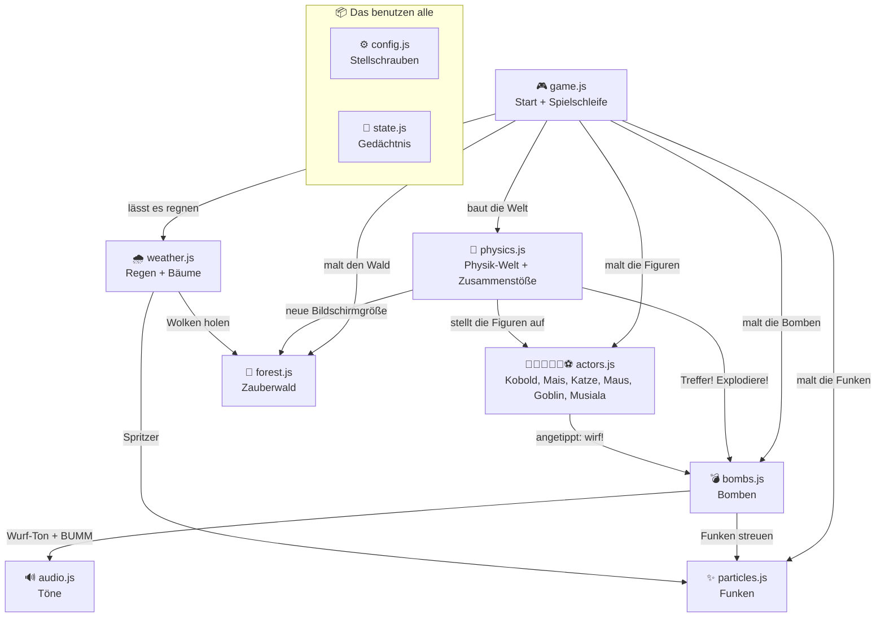

# 🎮 So funktioniert unser Spiel

Hallo! 👋 Schön, dass du in den Code schaust.
Du musst nicht alles auf einmal verstehen. Das Spiel besteht aus **9 kleinen Dateien**, und jede kümmert sich nur um **eine Sache**. Such dir die aus, die dich interessiert.

---

## 🗺️ Die Landkarte

| Datei | Worum geht es? | Schwierigkeit |
|---|---|---|
| ⚙️ [`config.js`](config.js) | Die **Stellschrauben**: Emojis, Größen, Schwerkraft | ⭐ Fang hier an! |
| 🔊 [`audio.js`](audio.js) | Alle **Töne** – ohne eine einzige Sounddatei | ⭐⭐ |
| 🖼️ [`sprites.js`](sprites.js) | Der **Bilder-Speicher**: Jedes Emoji wird nur EINMAL gemalt und dann kopiert – so bleibt das Spiel schnell 🚀 | ⭐⭐ |
| ✨ [`particles.js`](particles.js) | Die **Funken** bei einer Explosion | ⭐⭐ |
| 💀 [`knockout.js`](knockout.js) | **Lebensleiste** ❤️ – wer 20-mal getroffen wird, ist **raus**. Die letzte Figur **gewinnt** 🏆 | ⭐⭐ |
| 🎮 [`cpu.js`](cpu.js) | **Wen spielst du?** Die Figuren-Auswahl am Anfang – und die **Computer-Gegner**, die von allein werfen | ⭐⭐ |
| 🏅 [`levels.js`](levels.js) | **5 Level** – jedes schwerer. Das große „LEVEL 2“-Schild und „WEITER ➡️“ | ⭐⭐ |
| 🎬 [`credits.js`](credits.js) | Der **Abspann**: alle eure Wünsche mit Versionsnummer – wie im Kino! | ⭐ |
| ⚔️ [`teams.js`](teams.js) | **Team-Modus**: Du wählst mehrere Figuren 🔵, die Gegner sind rot 🔴 – und jedes Level bringt **mehr Gegner** | ⭐⭐⭐ |
| ⚡ [`specials.js`](specials.js) | **Spezialkräfte** (Knopf unten links – lädt auf, wenn du 20-mal triffst): ⚽ Musialas lenkbarer Riesenball, 🧌 Mini-Kobolde als Schutzschild, 🐱 Katzen-Wirbelsprung 🌪️, 🌽 Popcorn-Regen 🍿, 👺 brennender Feuerspeer 🔥 | ⭐⭐⭐ |
| ⚽ [`footballer.js`](footballer.js) | Malt **Musiala im Trikot** – Strich für Strich – und lässt ihn **dribbeln** | ⭐⭐ |
| 🌧️ [`weather.js`](weather.js) | **Regen** aus den Wolken, unten **wachsen Bäume** – und was passiert, wenn du den Himmel antippst | ⭐⭐ |
| 🎮 [`game.js`](game.js) | Das **Herz**: Start und Spielschleife | ⭐⭐ |
| 💣 [`bombs.js`](bombs.js) | Bomben **werfen** und **explodieren** lassen | ⭐⭐⭐ |
| 🧌🌽🐱🐭👺⚽ [`actors.js`](actors.js) | Die Figuren **Kobold**, **Mais**, **Katze**, **Maus**, **Goblin** und **Musiala** | ⭐⭐⭐ |
| 🌲 [`forest.js`](forest.js) | Der **Zauberwald** im Hintergrund | ⭐⭐⭐ |
| 🧪 [`physics.js`](physics.js) | Die **Physik-Welt**: Wände und Zusammenstöße | ⭐⭐⭐ |
| 🧠 [`state.js`](state.js) | Das **Gedächtnis**: Punkte, Spielfeldgröße, … | ⭐ (kurz, aber wichtig) |

---

## 🕸️ Wer redet mit wem?

Ein Pfeil bedeutet: *„Diese Datei ruft eine Funktion aus der anderen Datei auf."*



Lies das Bild von oben nach unten: `game.js` ist der **Chef** und gibt die Aufträge. `audio.js` und `particles.js` stehen ganz unten – sie rufen niemanden auf, sie machen einfach nur ihre Arbeit, wenn jemand sie braucht.

`config.js` und `state.js` haben keine Pfeile, weil **jede** Datei bei ihnen nachschaut. Das wären sonst so viele Pfeile, dass man nichts mehr erkennt.

---

## 🔁 Die wichtigste Idee: die Spielschleife

Ein Spiel ist wie ein **Daumenkino**. Der Computer malt ungefähr **60 Bilder pro Sekunde**, und jedes Bild ist ein kleines bisschen anders als das davor. So entsteht Bewegung.

Das passiert in `gameLoop()` in [`game.js`](game.js) – immer wieder, in dieser Reihenfolge:

```
1. 🌲 Hintergrund malen        → drawForest()     (forest.js)
   🌧️ Regen & Bäume malen      → drawWeather()    (weather.js)
2. 🧌 Figuren malen           → drawActors()     (actors.js)
3. 🧪 Physik weiterrechnen     → Engine.update()  (Matter.js)
4. 💣 Bomben malen             → updateBombs()    (bombs.js)
5. ✨ Funken malen             → drawParticles()  (particles.js)
        ⤴ … und wieder von vorne!
```

Die Reihenfolge ist wie beim Malen mit Deckfarben: Was **zuletzt** gemalt wird, liegt **oben**. Deshalb kommt der Wald zuerst und die Funken zum Schluss.

---

## 💥 Was passiert, wenn du den Kobold antippst?

1. [`actors.js`](actors.js) merkt: *„Der Kobold wurde angetippt!"* und ruft `shootBomb('kobold')`.
2. [`bombs.js`](bombs.js) baut eine Bombe 💣, rechnet aus, wie fest sie geworfen werden muss, damit sie beim Mais landet, und wirft sie los.
3. [`audio.js`](audio.js) spielt den Wurf-Ton.
4. **Matter.js** (die Physik-Maschine) lässt die Bombe im Bogen fliegen – Schwerkraft inklusive.
5. [`physics.js`](physics.js) bemerkt den Zusammenstoß: *„Bombe trifft Mais!"* → **+1 Treffer**.
6. [`bombs.js`](bombs.js) lässt die Bombe explodieren, [`particles.js`](particles.js) streut die Funken, [`audio.js`](audio.js) macht **BUMM**.

Geworfen wird immer im Kreis: **Kobold → Mais → Katze → Maus → Goblin → Musiala → Kobold**. Wer auf wen wirft, steht bei `target` in der Liste `actors` in [`actors.js`](actors.js).

Sechs Dateien arbeiten zusammen – wie eine Mannschaft, in der jeder seine Position hat.

Und wenn du in den **Himmel** tippst? Dann schaut `handleSkyTap()` in [`weather.js`](weather.js) nach, was da ist: ☁️ eine Wolke → sie regnet. ☀️ die Sonne → es wird Nacht. 🌙 der Mond → es wird wieder Tag.

Und wenn du eine Figur **ziehst** statt tippst? Dann bewegt `moveActor()` in [`actors.js`](actors.js) sie an die neue Stelle. So kannst du Bomben ausweichen.

---

## 🧪 Probier's aus!

Ändere eine Zahl, speichere die Datei und lade die Seite neu. Kaputtmachen kannst du nichts – im Notfall änderst du die Zahl einfach zurück.

### ⚙️ In `config.js` (am einfachsten)

| Ändere … | … und es passiert |
|---|---|
| `koboldEmoji: '🧌'` → `'🐉'` | Der Kobold wird ein Drache |
| `cornEmoji: '🌽'` → `'🥒'` | Aus Mais wird eine Spreewald-Gurke |
| `katzeEmoji: '🐱'` → `'🦁'` | Aus der Katze wird ein Löwe |
| `mausBomb: '🧀'` → `'🍕'` | Die Maus wirft Pizza statt Käse |
| `koboldTrail: '🪙'` → `'💎'` | Aus dem Goldsack fallen Diamanten |
| `katzeBomb: '🐟'` → `'🐠'` | Die Katze wirft bunte Fische |
| `goblinBomb: '🔥'` → `'❄️'` | Der Goblin wirft Schneebälle statt Feuer |
| `musialaBomb: '⚽'` → `'🏀'` | Musiala wechselt zum Basketball |
| `musialaShirt` → `color: '#dc2626'` | Rotes Trikot statt weißem |
| `musialaShirt` → `number: '42'` | Andere Rückennummer |
| `musialaShirt` → `sixSeven: true` | Musiala jubelt wieder mit 6-7 🤲 |
| `musialaRunSpeed: 1.5` → `4` | Turbo-Sprint! 🏃💨 |
| `musialaRuns: true` → `false` | Musiala bleibt stehen |
| `levels` → bei Level 5 `throwMs: 1700` → `500` | Level 5 wird zur Hölle 🔥 |
| `levels` → `huntPlayer: 0.5` → `1` | In dem Level zielen ALLE nur auf dich 🎯 |
| `teamLevels` → bei Level 8 `enemies: 10` → `20` | 20 Gegner auf einmal! 😱 |
| `hitChoices: [5, 10, 20, 50]` → `[1, 100]` | Andere Auswahl auf dem Startbildschirm 💀 |
| `bigBall` → `damage: 3` → `10` | Musialas Riesenball haut alles um ⚽💥 |
| `miniKobolds` → `count: 3` → `8` | Eine ganze Mini-Kobold-Armee 🧌🧌🧌 |
| `catStunSeconds: 4` → `10` | Die Wirbelwolke hält 10 Sekunden 🌪️ |
| `popcorn` → `count: 10` → `40` | Popcorn-Sturm 🍿🍿🍿 |
| `fireSpear` → `burnSeconds: 3` → `10` | Feuer brennt 10 Sekunden 🔥 |
| `specialChargeHits: 20` → `3` | Spezialkraft schon nach 3 Treffern ⚡ |
| `maxHits: 20` → `5` | Schnelles Spiel – nach 5 Treffern ist eine Figur raus 💀 |
| `dayMode: true` → `false` | Tag ☀️ wird Nacht 🌙 (Sterne, Mond, Glühwürmchen) |
| `rain: false` → `true` | Alle Wolken regnen immer 🌧️ |
| `rainSeconds: 8` → `30` | Eine angetippte Wolke regnet lange |
| `rainAmount: 0.3` → `1` | Wolkenbruch! 🌧️ |
| `treeChance: 0.02` → `0.2` | Turbo-Wald – überall sprießen Bäume 🌱 |
| `treeEmojis` → `['🌻', '🌷']` | Statt Bäumen wachsen Blumen |
| `bombEmoji: '💣'` → `'🍕'` | Pizza-Schlacht! |
| `gravityY: 0.9` → `0.2` | Schwerkraft wie auf dem Mond – Bomben fliegen in hohem Bogen |
| `gravityY: 0.9` → `2.5` | Riesen-Schwerkraft – Bomben sausen flach und schnell |
| `koboldSize: 70` → `140` | Riesen-Kobold |
| `moonEmoji: '🌙'` → `'🛸'` | Ein Ufo über dem Wald |

### 🔊 In `audio.js`

Ein Ton wird so gemacht: `playTone(600, 'square', 0.08, 0.15)`

- **600** = Tonhöhe. Kleine Zahl = tief, große Zahl = hoch.
- **'square'** = Klangfarbe. Probier `'sine'` (weich), `'triangle'` (rund), `'sawtooth'` (kratzig).
- **0.08** = wie lange der Ton dauert (in Sekunden).
- **0.15** = Lautstärke. Bitte nicht über `0.3` – sonst tut es in den Ohren weh.

### ✨ In `particles.js` und `bombs.js`

- In `explodeBomb()` steht `spawnParticles(x, y, '#ff9f1c', 30)`. Die **30** ist die Anzahl der Funken. Mach daraus **200**!
- `'#ff9f1c'` ist eine Farbe (Orange). Probier `'#ff00ff'` (Pink) oder `'#00ffff'` (Türkis).

### 🌲 In `forest.js`

- In `initForest()` steht `i < 35` bei den Sternen. Mach **300** daraus für einen Sternenhimmel (nur bei Nacht: `dayMode: false`).
- Bei den Glühwürmchen steht `i < 16`. Wie sieht der Wald mit **100** aus?

---

## 📖 Kleines Wörterbuch

| Wort | Bedeutung |
|---|---|
| **Variable** | Eine beschriftete Schachtel, in der sich der Computer etwas merkt. `let score = 0` heißt: *Schachtel „score", Inhalt 0.* |
| **Funktion** | Ein Rezept mit Namen. `function shootBomb()` beschreibt, *wie* man eine Bombe wirft. Mit `shootBomb()` wird das Rezept gekocht. |
| **Canvas** | Die Leinwand, auf die das Spiel malt. |
| **`ctx`** | Der Pinsel für die Leinwand. `ctx.fillText('🌽', …)` malt einen Mais. |
| **Body** | Ein Körper in der Physik-Welt. Er hat einen Ort, eine Geschwindigkeit und kann anstoßen. |
| **Engine** | Die Physik-Maschine (Matter.js). Sie rechnet aus, wohin alles fliegt und fällt. |
| **Kollision** | Zwei Körper stoßen zusammen. |
| **Partikel** | Ein winziger bunter Punkt. Viele zusammen sehen aus wie eine Explosion. |
| **Wiggle** | Englisch für „wackeln". Die Figuren wackeln kurz, wenn sie werfen oder getroffen werden. |
| **`width` / `height`** | Breite und Höhe des Spielfelds in Pixeln. |
| **`now`** | Die aktuelle Zeit in Millisekunden. Damit weiß das Spiel, wie weit eine Bewegung schon ist. |
| **`//`** | Ein Kommentar. Den liest nur der Mensch, der Computer überspringt ihn. |

---

## 🧩 Wie finden die Dateien einander?

In der [`index.html`](../index.html) stehen ganz unten alle Dateien untereinander. Der Browser liest sie **von oben nach unten**. Alles, was eine Datei anlegt, können die Dateien danach benutzen – wie ein gemeinsamer Werkzeugkasten.

Deshalb gibt es zwei Regeln:

1. **Jeder Name nur einmal.** Wenn zwei Dateien beide `let score` schreiben, streikt der Browser.
2. **`game.js` steht ganz unten.** Sie startet das Spiel – und das geht erst, wenn alle anderen ihr Werkzeug in den Kasten gelegt haben.

---

## 🚀 Eigene Idee?

Du willst etwas Neues einbauen, zum Beispiel einen Schutzschild oder einen zweiten Kobold?

1. Lege eine neue Datei an, z. B. `shield.js`.
2. Trage sie in der `index.html` ein – **vor** `game.js`.
3. Schreib eine Funktion wie `drawShield()` und rufe sie in `gameLoop()` auf.

Viel Spaß beim Ausprobieren! 🌲🧌🌽
